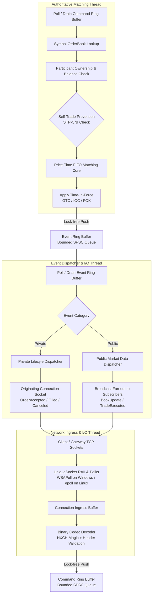

# ⚡ Helix Simulated Exchange & Matching Engine

[](https://en.cppreference.com/w/cpp/20)
[](https://cmake.org/)
[](https://www.typescriptlang.org/)
[](https://react.dev/)
[](https://www.postgresql.org/)
[](https://www.docker.com/)
[](LICENSE)

A high-performance, low-latency **simulated limit-order exchange and matching engine** written in **modern C++20**, paired with an asynchronous **TypeScript / WebSocket gateway** and a real-time **React trading terminal**.

Designed from first principles with a focus on low-latency trading systems engineering: highlights thread isolation, lock-free SPSC queues, strict deterministic matching, binary framing, and measured execution latency without third-party matching dependencies.

> ⚠️ **Disclaimer:** This is an educational trading simulator. It is **not** connected to any real exchange, does **not** process real funds, and is **not** intended as production financial infrastructure.

---

## 🏛️ System Architecture

```
  ┌────────────────────────────────────────────────────────┐
  │              React / Vite Terminal (:5173)             │
  │     Order Entry, Depth Book, Live Trades, Positions    │
  └───────────────────────────┬────────────────────────────┘
                              │ JSON over HTTP & WebSocket
                              ▼
  ┌────────────────────────────────────────────────────────┐
  │              TypeScript Gateway (:3001)                │
  │    • Session & Auth (scrypt)      • PostgreSQL 16      │
  │    • Wire Codec (JSON ↔ Binary)   • Auto-reconnect TCP │
  └───────────────────────────┬────────────────────────────┘
                              │ Versioned Binary Protocol (HXCH frames)
                              ▼
  ┌────────────────────────────────────────────────────────┐
  │              C++20 Helix Engine (:9001)                │
  │                                                        │
  │   ┌────────────────────┐      ┌────────────────────┐   │
  │   │   I/O Thread       │      │  Matching Thread   │   │
  │   │                    │      │                    │   │
  │   │  • Non-blocking    │      │  • Authoritative   │   │
  │   │    WSAPoll / epoll ├──────►    Matching Loop   │   │
  │   │  • Binary Framing  │ SPSC │  • Price-Time FIFO │   │
  │   │  • Egress Fan-out  │◄─────┤  • O(1) Lookups    │   │
  │   └────────────────────┘ SPSC └────────────────────┘   │
  │                                 Independent Books:     │
  │                                 BTC-USDT, ETH-USDT...  │
  └────────────────────────────────────────────────────────┘
```

### Responsibility Separation

| Layer | Technology | Primary Responsibilities |
| :--- | :--- | :--- |
| **Trading Terminal** | React 18, Vite, TypeScript | Responsive trading dashboard, symbol switching, live book depth, user order tracking, cancel/modify interactions. |
| **Access Gateway** | Node.js, Express, `ws`, PostgreSQL | User authentication (scrypt), session token lifecycle, PostgreSQL migrations, connection mapping, protocol translation. |
| **Exchange Core** | C++20 (MSVC / GCC / Clang) | Authoritative order books, sub-microsecond matching loop, deterministic state mutations, thread-safe SPSC communication. |

---

## 🔄 C++ Matching Engine Pipeline

The C++ engine strictly isolates socket I/O from the matching critical path. The matching thread is the **sole writer** to in-memory order books, guaranteeing single-writer determinism without mutex contention.



### 📋 What Happens to an Inbound Order (Step-by-Step)

1. **Socket Ingress:** The `Poller` notifies readiness. Raw bytes are read into a per-connection buffer.
2. **Binary Framing:** The connection decoder validates magic bytes (`0x48584348`), message type, and payload length before constructing a strongly typed `Command`.
3. **SPSC Ingress Queue:** Complete commands are placed into a bounded, wait-free Single-Producer Single-Consumer (SPSC) ring buffer without allocating dynamic memory.
4. **Symbol Selection:** The matching thread pops the command and selects the symbol's independent `OrderBook`.
5. **Pre-trade Validation:** Validates price ticks (integer arithmetic only), positive quantities, and order existence.
6. **Self-Trade Prevention (STP-CNI):** If an aggressor would cross with an existing order from the same participant, the newest portion is canceled to prevent wash trades.
7. **Execution & Allocation:** Aggressive matching proceeds against resting orders at the **maker's price** in strict FIFO order.
8. **Time-in-Force Enforcement:**
   - **GTC (Good-Til-Cancel):** Unfilled remainder rests in the book.
   - **IOC (Immediate-Or-Cancel):** Unfilled remainder is canceled immediately.
   - **FOK (Fill-Or-Kill):** Scans depth first; if full fill is impossible, rejects without modifying book.
9. **Event Generation & Egress:** Typed events are emitted into the return SPSC ring. The I/O thread drains events and streams private confirmations and public market updates back to connected sessions.

---

## ⚡ Performance & Benchmarks

Helix includes `helix_bench`, an in-process matching harness that exercises the raw execution loop without socket overhead.

### Measured Benchmark Run

*Captured on development workstation (MSVC 1950, Release `-O2`, AMD Ryzen 7 8845H):*

```text
Helix matching microbenchmark (in-process execute(), no sockets)
engine:          helix-engine 0.1.0
compiler:        MSVC 1950 / C++20
build:           Release (NDEBUG)
workload:        100,000 mixed orders (limit entry, crossing trades, cancels)
wall_seconds:    0.088366 s
throughput:      1,131,650 orders/sec
latency_p50:     500 ns   (clock-resolution lower bound)
latency_p99:     1,700 ns (1.70 µs)
latency_max:     10.86 ms (heap reallocation & cache cold-miss)
```

*(For full methodology and host specs, see [docs/performance.md](docs/performance.md).)*

---

## 📦 Key Trading & Technical Features

- [x] **Sub-microsecond Matching Engine:** Native C++20 price-time priority implementation using integer fixed-point ticks (zero floating-point operations on hot path).
- [x] **Lock-Free Concurrency:** Single-producer single-consumer (SPSC) ring buffers with memory fences prevent mutex lock contention.
- [x] **Deterministic Replay:** Built-in `helix_replay` CLI loads text command tapes and verifies outputs against golden logs for byte-for-byte regression testing.
- [x] **Self-Trade Prevention:** Strict STP-CNI (Cancel Newest) protects participant accounts against unintentional wash trading.
- [x] **Time-in-Force Rules:** Comprehensive handling for `GTC`, `IOC`, and all-or-nothing `FOK` orders.
- [x] **Order Ownership & Modify:** Order cancel and replacement enforce owner participant credentials. Size-downs preserve queue priority; size-ups or price adjustments forfeit queue priority.
- [x] **Cross-platform Polling:** Decoupled `Poller` interface supporting `WSAPoll` on Windows and `epoll` on Linux.
- [x] **Full-Stack Integration:** Complete with PostgreSQL identity management, scrypt password hashing, WebSocket streaming, and a React Vite trading desk.

---

## 🚀 Quickstart & Local Bootstrap

### Prerequisites
- **C++ Compiler:** MSVC (Visual Studio 2022+), GCC 12+, or Clang 15+ supporting C++20.
- **CMake:** Version 3.20 or newer.
- **Node.js:** v18+ and npm.
- **Docker:** Docker Compose (for PostgreSQL).

---

### Option A: One-Command Local Bootstrap

#### On Windows (PowerShell):
```powershell
.\scripts\start-local.ps1
```

#### On Linux / macOS (Bash):
```bash
chmod +x ./scripts/start-local.sh
./scripts/start-local.sh
```

---

### Option B: Manual Step-by-Step Setup

#### 1. Start Database & Copy Config
```bash
cp .env.example .env
docker compose up -d postgres
```

#### 2. Build the C++ Engine & Run Tests
```bash
cmake -B build -S . -DCMAKE_BUILD_TYPE=Release
cmake --build build --config Release

# Run test suite (56/56 tests passing)
./build/engine/Release/helix_tests.exe    # Windows
# ./build/engine/helix_tests             # Linux
```

#### 3. Start the C++ Matching Engine
```bash
./build/engine/Release/helix_engine.exe   # Listening on 0.0.0.0:9001
```

#### 4. Run Gateway Migrations & Start Gateway
```bash
cd gateway
npm install
npm run migrate
npm run dev                             # Listening on http://localhost:3001
```

#### 5. Start Trading Terminal
```bash
cd ../terminal
npm install
npm run dev                             # Open http://localhost:5173
```

---

## 🧪 Testing & Verification

The project includes unit, integration, and replay test suites across all components:

```bash
# 1. C++ matching, framing, and queue tests
ctest --test-dir build -C Release --output-on-failure

# 2. Deterministic Replay Test
./build/engine/Release/helix_replay.exe engine/tapes/cross.tape

# 3. TypeScript Gateway Protocol Codec Tests
cd gateway && npm test

# 4. React Terminal Typecheck & Build
cd terminal && npm run build
```

---

## 📂 Project Structure

```text
├── engine/                 # C++20 Core Exchange
│   ├── include/helix/      # Public headers (OrderBook, EngineService, SPSC, Codec)
│   ├── src/                # Implementation (matching_engine, socket, poller, wire)
│   ├── tests/              # Test suite (matching, cancel/modify, TIF, networking)
│   ├── bench/              # Throughput & latency microbenchmark harness
│   └── tapes/              # Deterministic replay tape files & golden outputs
├── gateway/                # TypeScript / Express / WebSocket Gateway
│   ├── src/                # Auth, PostgreSQL client, engine TCP bridge, codec
│   └── migrations/         # PostgreSQL DDL migrations
├── terminal/               # React + Vite Trading Desk Frontend
│   └── src/                # Order form, Depth book table, recent trade tickers
├── docs/                   # Engineering documentation
│   ├── matching.md         # Matching rules, STP-CNI, complexity analysis
│   ├── pipeline.md         # SPSC queue design, backpressure, thread boundaries
│   ├── protocol.md         # Binary wire specification & message layouts
│   ├── performance.md      # Reproducible benchmark logs & hardware notes
│   └── troubleshooting.md  # Common local development diagnostics
└── scripts/                # Local start & bootstrap scripts (sh, ps1)
```

---

## 📄 License

This project is licensed under the [MIT License](LICENSE).
